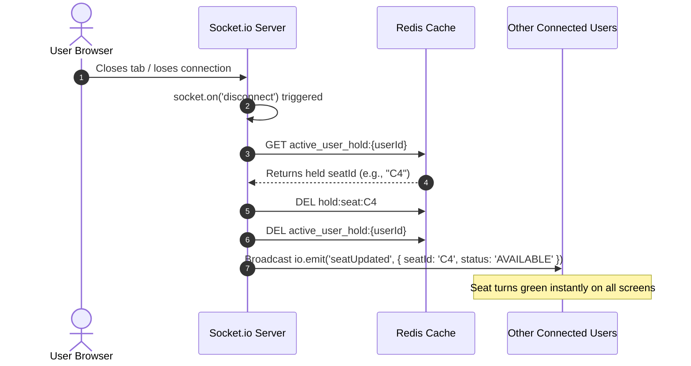
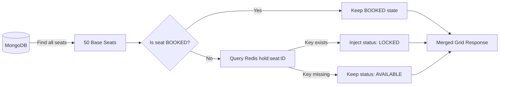

# ⚡ Architecture & Concurrency Control

This document explains the distributed locking mechanisms, concurrency guarantees, and real-time state synchronization used across the application.

---

## 🏛️ The Two-Database Hybrid Model

High-concurrency ticketing systems encounter a classic trade-off: **Speed** vs. **Persistence**.

| Dimension | Temporary State (Locks / Carts) | Permanent State (Tickets / Users) |
| :--- | :--- | :--- |
| **Storage Engine** | **Upstash Redis** (In-Memory) | **MongoDB Atlas** (Disk / ACID-like Document) |
| **Operation Type** | Sub-millisecond reads/writes, key auto-expiration | Relational references, persistent storage, audits |
| **Write Volatility** | High (transient holds created and dropped frequently) | Low (only written upon confirmed checkout) |
| **Failure Cost** | Minimal (lock simply releases back to pool) | Critical (ticket loss or corruption cannot occur) |

### Key Rule: The Source of Truth
* **Redis** is the absolute source of truth for **active reservations in progress** (`LOCKED`).
* **MongoDB** is the absolute source of truth for **confirmed purchases** (`BOOKED`) and **baseline inventory** (`AVAILABLE`).
* The seat model in MongoDB **never stores the `LOCKED` status**. The `GET /api/seats` handler merges MongoDB records with live Redis keys dynamically before returning data to the client.

---

## 🔒 Distributed Locking Mechanics

When a user clicks an available seat, the system executes an atomic distributed lock via Redis:

```javascript
// backend/routes/seatRoutes.js
const lockAcquired = await redisClient.set(`hold:seat:${seatId}`, userId, {
    EX: 300, // 5-minute TTL (Time To Live)
    NX: true // Only set the key if it does NOT already exist
});
```

### Why `SET ... NX EX`?
* **Atomicity:** The check for key existence and the key assignment happen in a single, indivisible CPU cycle on the single-threaded Redis engine. No two clients can both pass the check simultaneously.
* **Mutual Exclusion (`NX: true`):** If User 1 and User 2 click seat `C4` within 1 millisecond of each other:
  1. User 1's command executes first: key `hold:seat:C4` is created. Returns `'OK'` (truthy).
  2. User 2's command executes second: key already exists. Redis rejects the write and returns `null` (falsy).
  3. The server immediately returns HTTP 409 Conflict to User 2: `"Seat is currently being held by another user"`.
* **Automatic Expiration (`EX: 300`):** Even if the user's computer crashes, the network fails, or the server restarts, Redis will evict the key automatically after 300 seconds (5 minutes), freeing the seat without requiring any cron job.

---

## 🧭 Reverse Lookup Architecture

A standard Redis hold maps a **Seat ID to a User ID**:
$$\text{hold:seat:C4} \longrightarrow \text{"65f1234abcd"}$$

However, when a user's WebSocket abruptly disconnects, the server receives the user's `userId`, not the seat they were holding. Without a reverse index, finding which seat they held would require scanning all `hold:seat:*` keys in Redis ($O(N)$ full scan, dangerous under high load).

To solve this, the server creates a **secondary reverse lookup key**:

```javascript
// Created when locking:
await redisClient.setEx(`active_user_hold:${userId}`, 300, seatId);
```

$$\text{active_user_hold:65f1234abcd} \longrightarrow \text{"C4"}$$

### Clean-Up Sequence on Socket Disconnect



---

## 🛡️ Concurrency & Security Safeguards

### 1. Purchase Verification Check
During permanent checkout (`POST /api/seats/book`), the backend performs a strict ownership verification before committing to MongoDB:

```javascript
const currentLockOwner = await redisClient.get(`hold:seat:${seatId}`);

if (!currentLockOwner) {
    return res.status(400).json({ error: 'Checkout expired. You must lock the seat first.' });
}

if (currentLockOwner != userId) {
    return res.status(403).json({ error: 'The seat is locked by another user.' });
}
```
This protects against:
* Malicious users attempting to forge requests to book a seat held by someone else.
* Slow checkouts where the 5-minute timer expired just before the user clicked "Confirm Purchase".

### 2. MongoDB Unbook Ownership Cast
When releasing a booked seat (`POST /api/seats/unbook`), MongoDB stores `bookedBy` as an `ObjectId`. The request payload contains `userId` as a plain string.
To prevent Mongoose equality mismatches:

```javascript
if (!seat || seat.status !== 'BOOKED' || String(seat.bookedBy) !== String(userId)) {
    return res.status(400).json({ error: 'Cannot release this seat. You may not own it.' });
}
```

### 3. Grid Fetch State Merging
When `GET /api/seats` is called:


---

## 📡 Real-Time WebSocket Pipeline

* **Transport:** WebSockets with HTTP long-polling fallback managed by `Socket.io`.
* **Connection Handshake:** Client connects using `io(API_URL, { query: { userId } })`.
* **Broadcast Channel:**
  * Event Name: `seatUpdated`
  * Payload: `{ seatId: string, status: 'AVAILABLE' | 'LOCKED' | 'BOOKED' }`
* **Trigger Points:**
  1. `POST /api/seats/lock` $\rightarrow$ Emits `status: 'LOCKED'`
  2. `POST /api/seats/book` $\rightarrow$ Emits `status: 'BOOKED'`
  3. `POST /api/seats/unlock` $\rightarrow$ Emits `status: 'AVAILABLE'`
  4. `POST /api/seats/unbook` $\rightarrow$ Emits `status: 'AVAILABLE'`
  5. `socket.on('disconnect')` $\rightarrow$ Emits `status: 'AVAILABLE'`

