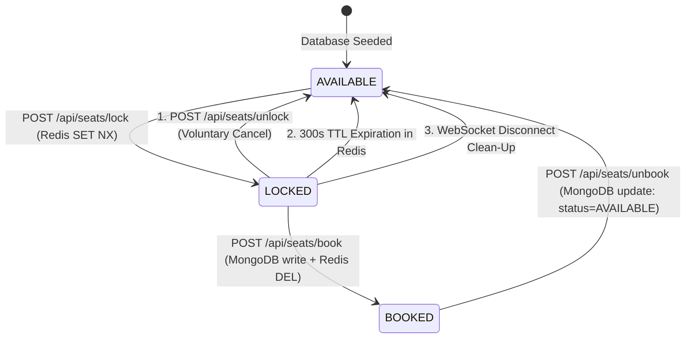

# 🗄️ Database & Schema Reference

This document details the MongoDB document schemas, Redis key namespaces, and the lifecycle state machine governing seats.

---

## 🍃 MongoDB Document Schemas

### 1. Seat Model ([`backend/models/Seat.js`](file:///c:/Workspace/My%20Projects/Seat%20Booking%20System/backend/models/Seat.js))

Stores persistent seat records and permanent booking ownership.

```javascript
const seatSchema = new mongoose.Schema({
    seatId: {
        type: String,
        required: true,
        unique: true
    },
    status: {
        type: String,
        enum: ['AVAILABLE', 'BOOKED'],
        default: 'AVAILABLE'
    },
    bookedBy: {
        type: mongoose.Schema.Types.ObjectId,
        ref: 'User',
        default: null
    },
    bookedAt: {
        type: Date,
        default: null
    }
}, { timestamps: true });
```

#### Field Specifications
| Field | Type | Required | Unique | Default | Description |
| :--- | :--- | :---: | :---: | :---: | :--- |
| `seatId` | `String` | Yes | Yes | — | Row + Column code (e.g., `'A1'`, `'E10'`). |
| `status` | `String` | Yes | No | `'AVAILABLE'` | Restricted to `'AVAILABLE'` or `'BOOKED'`. (*`LOCKED` is not stored here*). |
| `bookedBy` | `ObjectId` | No | No | `null` | Reference to the `_id` of the purchasing `User`. |
| `bookedAt` | `Date` | No | No | `null` | Timestamp when the booking was finalized. |
| `createdAt` | `Date` | Auto | No | Current Date | MongoDB auto-generated timestamp. |
| `updatedAt` | `Date` | Auto | No | Current Date | MongoDB auto-generated timestamp. |

---

### 2. User Model ([`backend/models/User.js`](file:///c:/Workspace/My%20Projects/Seat%20Booking%20System/backend/models/User.js))

Stores registered user profiles with bcrypt password hashing.

```javascript
const userSchema = new mongoose.Schema({
    username: {
        type: String,
        required: true,
        unique: true,
        trim: true
    },
    email: {
        type: String,
        required: true,
        unique: true,
        trim: true,
        lowercase: true
    },
    password: {
        type: String,
        required: true
    }
}, { timestamps: true });
```

#### Field Specifications
| Field | Type | Required | Unique | Description |
| :--- | :--- | :---: | :---: | :--- |
| `username` | `String` | Yes | Yes | Public display handle for the user. Cannot be changed after creation. |
| `email` | `String` | Yes | Yes | User's unique contact and login identifier (normalized lowercase). |
| `password` | `String` | Yes | No | Securely salted and hashed password using `bcryptjs` (cost 10). |
| `createdAt` | `Date` | Auto | No | Account creation timestamp. |
| `updatedAt` | `Date` | Auto | No | Account modification timestamp. |

---

## ⚡ Redis Key Namespaces & Data Structures

Redis is used strictly as a high-speed volatile cache for transient locks.

```
Redis Key Spaces
├── hold:seat:<seatId>      ──> Holds userId (String, TTL: 300s)
└── active_user_hold:<userId> ──> Holds seatId (String, TTL: 300s)
```

### 1. Primary Seat Lock
* **Pattern:** `hold:seat:<seatId>` (e.g., `hold:seat:B3`)
* **Type:** String
* **Value:** The MongoDB `_id` string of the user who holds the lock (e.g., `"66f1099ab9a12c001f44a7f0"`)
* **TTL:** 300 seconds (5 minutes)
* **Creation Command:** `SET hold:seat:<seatId> <userId> EX 300 NX`

### 2. Reverse User Hold Index
* **Pattern:** `active_user_hold:<userId>` (e.g., `active_user_hold:66f1099ab9a12c001f44a7f0`)
* **Type:** String
* **Value:** The `seatId` currently held by this user (e.g., `"B3"`)
* **TTL:** 300 seconds (5 minutes)
* **Creation Command:** `SETEX active_user_hold:<userId> 300 <seatId>`

---

## 🔄 The Complete Seat State Machine

A seat can transition through three distinct logical states:



### State Matrix
| State | Where Stored | Meaning | UI Interaction |
| :--- | :--- | :--- | :--- |
| `AVAILABLE` | MongoDB (`status: 'AVAILABLE'`) | Seat is free to be locked or booked | Clickable, glowing emerald border |
| `LOCKED` | Redis (`hold:seat:<seatId>`) | Under exclusive checkout hold (max 5 mins) | Pulsing amber, disabled for other users |
| `BOOKED` | MongoDB (`status: 'BOOKED'`) | Permanently purchased by a user | Dark slate, non-clickable, sold out |

---

## 🌱 Database Seeding & Maintenance

### Seed Script ([`backend/seed.js`](file:///c:/Workspace/My%20Projects/Seat%20Booking%20System/backend/seed.js))
The seed script resets and populates the database with 50 seats:
* **Rows:** `['A', 'B', 'C', 'D', 'E']` (5 rows)
* **Columns:** `1` through `10` (10 columns per row)
* **Total Records:** 50 documents (`A1` to `E10`)

#### Running the Seeder:
```bash
cd backend
node seed.js
```

> [!CAUTION]
> Running `seed.js` executes `Seat.deleteMany({})`, which purges all existing seat bookings and ownership records.

#### Soft-Resetting Bookings (Preserving Documents):
To reset all booked seats to `AVAILABLE` without deleting the collection, run this Mongoose query in Node or MongoDB Compass:
```javascript
await Seat.updateMany(
  { status: 'BOOKED' },
  { 
    $set: { 
      status: 'AVAILABLE', 
      bookedBy: null, 
      bookedAt: null 
    } 
  }
);
```

