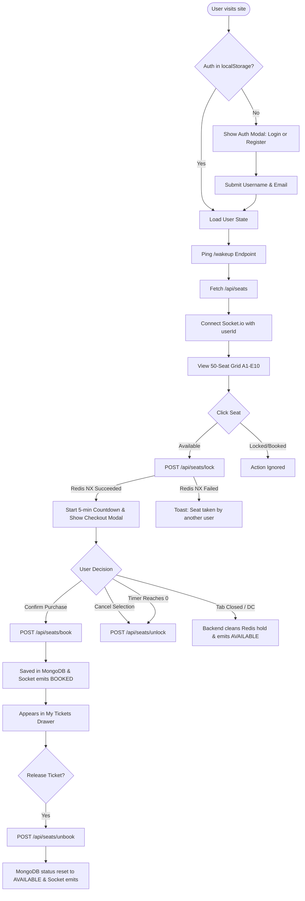

# 🌐 System Overview

The **VIP Seat Booking System** is a real-time, highly concurrent seat reservation platform engineered to handle peak traffic without race conditions or double bookings.

---

## 🎯 Core Objectives

1. **Zero Double-Booking Guarantee:** Eliminate race conditions when thousands of users attempt to select the same seat simultaneously.
2. **Sub-second Real-time State Synchronization:** Reflect seating status changes (Available, Held, Sold Out) instantly across all connected clients.
3. **Resilient Failure Recovery:** Automatically release seats back to the public pool if a user abandons their cart, closes their browser, or loses network connectivity.
4. **Low-Friction User Experience:** Passwordless authentication that gets attendees straight to seat selection without complex verification flows.

---

## 🛠️ Technology Stack Breakdown

### Frontend Client
* **Framework:** React 19 (`react: ^19.2.0`, `react-dom: ^19.2.0`)
* **Build Tool:** Vite 7 (`vite: ^7.3.1`, `@vitejs/plugin-react: ^5.1.1`)
* **Styling Engine:** Tailwind CSS v4 (`tailwindcss: ^4.2.1`, `@tailwindcss/vite: ^4.2.1`)
* **Animation Library:** Framer Motion (`framer-motion: ^12.35.0`)
* **Real-time Client:** Socket.io-client (`socket.io-client: ^4.8.3`)
* **State Management:** React local state (`useState`, `useEffect`) and browser `localStorage`

### Backend Server
* **Runtime:** Node.js (CommonJS modules)
* **Web Framework:** Express 5 (`express: ^5.2.1`)
* **Real-time Server:** Socket.io (`socket.io: ^4.8.3`) wrapped over native `node:http`
* **In-Memory Cache & Distributed Lock:** Redis 5 (`redis: ^5.11.0`) hosted on Upstash
* **Primary Database ODM:** Mongoose 9 (`mongoose: ^9.2.3`) connected to MongoDB Atlas Replica Set
* **Cross-Origin Handling:** CORS (`cors: ^2.8.6`)
* **Dev Process Management:** Nodemon (`nodemon: ^3.1.14`)

---

## 📁 Repository Directory Structure

```text
Seat Booking System/
├── backend/
│   ├── models/
│   │   ├── Seat.js            # MongoDB schema for permanent seat records
│   │   └── User.js            # MongoDB schema for user profiles
│   ├── routes/
│   │   ├── seatRoutes.js      # Seat transactions (GET grid, lock, book, unlock, unbook)
│   │   └── userRoutes.js      # Passwordless authentication (register, login)
│   ├── .env                   # Backend environment configuration (PORT, MONGO_URI, REDIS_URL)
│   ├── package.json           # Backend dependencies and scripts
│   ├── seed.js                # Database seeder (generates 50 seats: A1-E10)
│   └── server.js              # Server boot, Socket.io attachment, disconnect handler
├── client/
│   ├── public/
│   │   └── vite.svg           # Application logo asset
│   ├── src/
│   │   ├── components/
│   │   │   └── SeatDashboard.jsx # Single-page booking interface, modals, drawer, timer
│   │   ├── App.jsx            # Top-level shell rendering SeatDashboard
│   │   ├── index.css          # Tailwind CSS v4 import and base styles
│   │   └── main.jsx           # React DOM root initialization with StrictMode
│   ├── .env                   # Client environment variables (VITE_BACKEND_URL)
│   ├── eslint.config.js       # ESLint flat configuration
│   ├── index.html             # HTML shell
│   ├── package.json           # Client dependencies and build scripts
│   └── vite.config.js         # Vite configuration with React and Tailwind plugins
├── docs/                      # Agent & Developer Reference Documentation
└── README.md                  # Project overview and public documentation
```

---

## 🔄 End-to-End User Journeys



---

## 🚢 Production Deployment Architecture

* **Client Deployment:** Hosted on **Vercel** (`https://seat-booking-system-nu.vercel.app`).
* **Server Deployment:** Hosted on **Render** (Free tier web service with sleep-on-inactivity).
* **Caching & Locking:** **Upstash Redis** (Serverless, low-latency Redis over TLS).
* **Permanent Database:** **MongoDB Atlas** (M0 Replica Set on AWS).

### Cold-Start Accommodation
Free Render instances spin down after 15 minutes of inactivity. The client implements an automated wake-up polling loop (`wakeUpServer()` in [`SeatDashboard.jsx`](file:///c:/Workspace/My%20Projects/Seat%20Booking%20System/client/src/components/SeatDashboard.jsx#L123-L152)) with an `AbortController` (3s timeout) and a 5s retry cycle, alerting the user via toast while waiting for the server to wake up.

